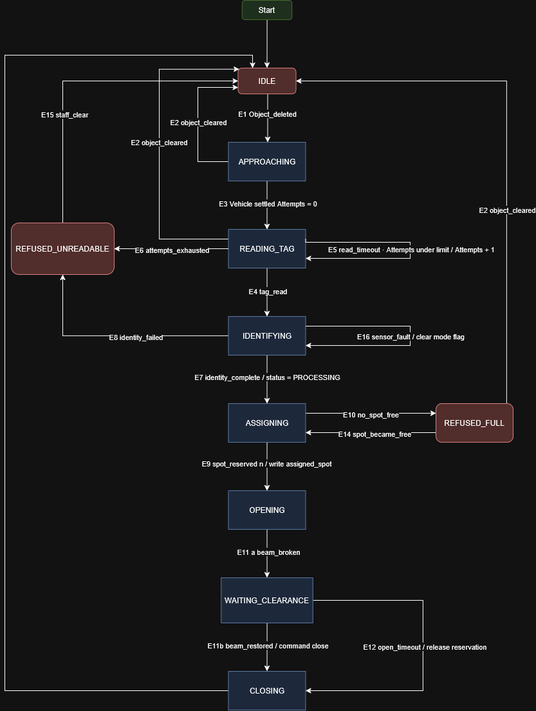

# State Machine

## Overview -

### The entrance phase is governed by one controller state machine - the <b>Entrance Gate</b> - which owns the sequence from a vehicle approaching to the barrier closing behind it. It runs on the Rasberry Pi 3. 

### Two other machines are touched but not owned here. The <b>Spot</b> machine makes its <b>FREE -> Reserved</b> transition on a command from this phase, and the <b>Vehicle</b> machine is created by this phase and handed on the parking phase. Both are defined in their own section; this document names only the transition the entrance causes.

### Exactly one Entrance Gate machine exist.

# 1. State -

| State | Meaning -> "right now the gate is..." |
|---|---|
| <b>IDLE</b> | Nothing at the gate. Barrier closed, LED red, Screen shows the default message. |
| <b>APPROACHING</b> | Something has beedn detected in the lane but has not settled at the read position. |
| <b>READING_TAG</b> | A vehicle is stopped at the reader. The system is attempting to read a tag. |
| <b>IDENTIFYING</b> | A tag UID has been read. Camera capture and weight measurement are in progress; the record is being created or found. |
| <b>ASSIGNING</b> | The vehicle is known. A free spot is being selected and reserved. |
| <b>OPENING</b> | A spot is reserved. The barrier has been commanded open; LED green; screen shows the spot number. |
| <b>WAITING_CLEARANCE</b> | Barrier open, vehicle passing through. |
| <b>CLOSING</b> | Clearance confirmed. The barrier is being closed. |
| <b>REFUSED_UNREADABLE</b> | No tag could be read within the attempt limit. Barrier shut, staff notified. |
| <b>REFUSED_FULL</b> | The vehicle is identified but no spot is free. Barrier shut, screen shows <b>Car Park Full</b>. |

### <b>Initial state</b>: <b>IDLE</b>, entered at system start after initialisation.

### <b>Terminal state</b>: none. The gate cycles indefinitely.

### <b>Why two refusal states and not one</b>

#### <b>RESUSED_UNREADABLE</b> and <b>REFUSED_FULL</b> look like the same situation - barrier shut, car waiting - but they leave by different doors. <b>REFUSED_FULL</b> resolves on its own when any spot becomes <b>FREE</b>. <b>REFUSED_UNREADABLE</b> cannot resolve without a person.

#### <b>Rule applied here, and worth stating in the report:</b> if two situation leave by the same exit, they are one state with a reason field. If they leave by different exits, they are different states. Collapsing them would hide the fact that one is self-healing and one is not.

### <b>Why <u>DERADED</u> isnot a state -

#### A load cell or camera fault does not change what the gate is doing - it changes how thoroughly it checks. Modelling it as a state would require a degraded twin of every state above, doubling the machine for no new behaviour.

### It is therefore a mode flag, not a state -

| Flag | Set When | Effect |
|---|---|---|
| <b>WEIGHT_AVAILABLE</b> | false on HX711 fault | <b>IDENTIFYING</b> skips the weight step; record flagged <b>WEIGHT_UNKNOWN</b> |
| <b>IMAGE_AVAILABLE</b> | false on camera fault | <b>IDENTIFYING</b> skips capture; record flagged <b>IMAGE_UNKNOWN |

### Both flags are owned by the Pi and cleared only by a successful read after a fault

# 2. Events -

| ID | Event | Source |
|---|---|---|
| E1 | <b>Object_detected</b> | Ultrasonic below threshold |
| E2 | <b>Object_cleared</b> | Ultrasonic above threshold |
| E3 | <b>vehicle_settled</b> | Distance stable at read position for T. |
| E4 | <b>tag_read(uid)</b> | Entrance RC522 |
| E5 | <b>read_timeout</b> | No tag within T<subset>2</subset> |
| E6 | <b>attempts_exhausted</b> | Attempt counter reached limit |
| E7 | <b>identity_complete</b> | Record created and found |
| E8 | <b>identity_failed</b> | Record lookup error |
| E9 | <b>spot_reserved(n)</b> | Spot machine confirmed <b>FREE->RESERVED</b> |
| E10 | <b>no_spot_free</b> | No spot in state <b>FREE</b> |
| E11 | <b>clearance</b> | Entrance clearance beam broken, the restored |
| E12 | <b>open_timeout</b> | No clearance within T<subset>3</subset> | 
| E13 | <b>barrier_closed</b> | Servo reached closed position |
| E14 | <b>spot_became_free</b> | Spot machine reported any spot -> <b>FREE</b> |
| E15 | <b>staff_clear</b> | Staff reset the gate |
| E16 | <b>sensor_fault(src) | HX711 or camera reported unavailable |

# 3. Transition Table -

| No. | Current | Event | Guard | Action | Next |
|---|---|---|---|---|---|
| T1 | <b>IDLE</b> | E1 | --- | Start approach timer | <b>APPROACHING</b> |
| T2 | <b>APPROACHING</b> | E3 | --- | <b>Attempts = 0</b>; screen <b>Present Tag</b> | <b>READING_TAG</b> |
| T3 | <b>APPROACHING</b> | E2 | --- | Cancel timer | <b>IDLE</b> |
| T4 | <b>READING_TAG</b> | E4 | --- | Hold UID | <b>IDENTIFYING</b> |
| T5 | <b>READING_TAG</b> | E5 | <b>Attempts < limit | <b>Attempts + 1; screen <b>Try Again</b> | <b>READING_TAG</b> |
| T6 | <b>READING_TAG</b> | E6 | --- | Notify staff; screen <b>Assistance Coming</b> | <b>REFUSED_UNREADABLE</b> |
| T7 | <b>READING_TAG</b> | E2 | --- | Abandon | <b>IDLE</b> | 
| T8 | <b>IDENTIFYING</b> | E7 | --- | Create or update record; status <b>PROCESSING</b> | <b>ASSIGNING</b> |
| T9 | <b>IDENTIFYING</b> | E8 | --- | Notify staff | <b>REFUSED_UNREADABLE</b> |
| T10 | <b>IDENTIFYING</b> | E16 | --- | Cleared the affected mode flag; flag the record; continue. | <b>IDENTIFYING</b> |
| T11 | <b>ASSIGNING</b> | E9 | --- | Write <b>assigned spot = n; screen <b>Go To Spot n</b> | <b>OPENING</b> |
| T12 | <b>ASSIGNING</b> | E10 | --- | Screen <b>Car Park Full</b> | <b>REFUSED_FULL</b> |
| T13 | <b>OPENING</b> | E11 | --- | --- | <b>WAITING_CLEARANCE</b> |
| T14 | <b>WAITING_CLEARANCE</b> | E11 | --- | Command close | <b>CLOSING</b> |
| T15 | <b>WAITING_CLEARANCE</b> | E12 | --- | Command close; release reservation; spot -> <b>FREE</b> | 
| T16 | <b>CLOSING</b> | E13 | --- | LED red; screen default; hand vehicle to parking phase | <b>IDLE</b> |
| T17 | <b>REFUSED_FULL</b> | E14 | Vehicle still at gate | Re-enter assignment | <b>ASSIGNING</b> |
| T18 | <b>REFUSED_FULL</b> | E2 | --- | Discard record | <b>IDLE</b> |
| T19 | <b>REFUSED_UNREADABLE</b> | E15 | --- | Reset | <b>IDLE</b> |

### T15 is the transition worth reading twice. A vehicle that is granted entry but never passes through must not keep a spot reserved. Without it, every abandoned approach permanently costs the car park one day.

## Unexpected events -

### Filling every state * event cell produce a 10 * 16 grid, most of it noise. The policy instead: 

#### <u>Any event not listed above is ignored and logged. It does not change state.</u>

### Two exception, which are listed because ignoring them would be wrong -

| Current | Event | Handling |
|---|---|---|
| <b>OPENING</b>,<b>WAITING_CLEARANCE</b>,<b>CLOSING</b> | E4 <b>tag_read</b> | Ignored. A second tag presented while a car is passing must not start a new entry sequence. | 
| any | E16 <b>sensor_fault</b> | Clears the mode flag immediately, in any state. Does not change state. |

### The grid was still checked cell by cell. The document records only the cells whose answer is not "ignore".

# 4. Diagram -

    

# 5. Invariants -

## True in every state, at all times :

### 1. The barrier opens only when a spot is <b>RESERVED</b> for the vehicle at the gate.
### 2. At most one vehicle is being processed at the gate at any movement.
### 3. <b>FREE -> RESERVED</b> is the only entry into <b>RESERVED</b>, and only this phase commands it.
### 4. No vehicle record exist without a tag UID.
### 5. The barrier never closes while the clearance beam is broken - enforced on the Arduino, not by this machine.
### 6. Every state except <b>IDLE</b> has a timeout. No state can be occupied indefinitely without an external event.
### 7. Leaving <b>ASSIGNING</b> without reaching <b>CLOSING</b> release the reservation.

# Failure and degraded behaviour -

| Failure | Detection | Response | Entry still possible? |
|---|---|---|---|
| HX711/load cell | No valid reading within timeout | <b>WEIGHT_AVAILABLE = false</b>; record flagged <b>WEIGHT_UNKNOWN</b> | Yes |
| Entrance camera | Capture error or no frame | <b>IMAGE_AVAILABLE = false</b>; record flagged <b>IMAGE_UNKNOWN</b> | Yes |
| Entrance RFID reader | Attempts exhausted on every vehicle | <b>REFUSED_UNREADABLE</b>; staff notified | No |
| Servo/barrier | No close confirmation within timeout | Gate out of service; staff notified | No |
| Power loss | --- | Backup battery holds the servo. On restore the barrier position is unknown: command close, then <b>IDLE</b> | After re-init |

# Interaction with other machines -

| This machine | Event in | Causes |
|---|---|---|
| <b>ASSIGNING -> OPENING</b> | T11 | Spot n: <b>FREE -> RESERVED</b> |
| <b>WAITING_CLEARANCE -> CLOSING</b> on timeout | T15 | Spot n: <b>RESERVED -> FREE</b> |
| <b>CLOSING -> IDLE</b> | T16 | Vehicle enters <b>PROCESSING</b>; control passes to the parking phase |
| <b>REFUSED_FULL -> ASSIGNING</b> | T17 | Triggered by the spot machine reporting any spot -> <b>FREE</b> | 